# Text Editor|deepin-editor|

## Overview

The text editor is a simple tool for editing text. You can use it to write simple text documents or leverage its advanced features to turn it into a code editor with syntax highlighting support.

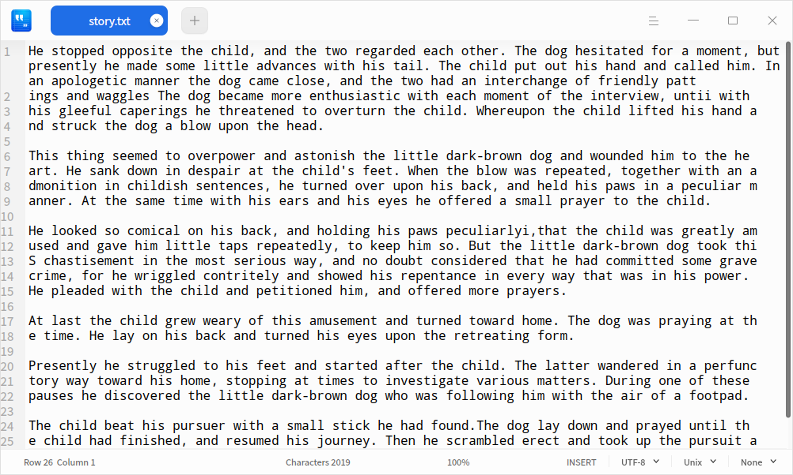

## Getting Started

### Launching the Text Editor

1. Click the Launcher icon  on the taskbar to enter the Launcher interface.
2. Scroll up and down with the mouse wheel or search to locate the Text Editor icon , then click to launch.
3. Right-click  to:
   - Click **Send to Desktop** to create a desktop shortcut.
   - Click **Send to Taskbar** to pin the application to the taskbar.
   - Click **Startup Automatically** to add the application to the startup items, enabling it to launch automatically when the computer boots.

### Exiting the Text Editor

- On the Text Editor interface, click  to exit.
- On the Text Editor interface, click the main menu  > **Exit** to quit.
- Right-click  on the taskbar and select **Close All** to exit.

### Viewing Shortcuts

On the Text Editor interface, use the shortcut **Ctrl + Shift + ?** to open the shortcuts preview panel. You can also view shortcuts in the settings interface. Mastering shortcuts will significantly improve your efficiency.

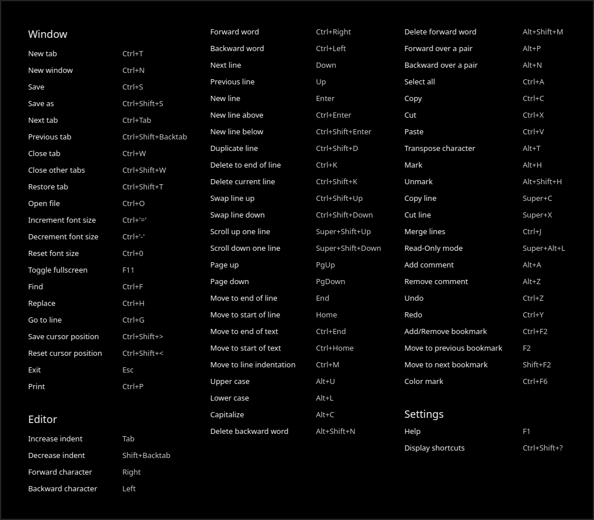

## Basic Operations

### Managing Tabs

- **New Tab/Window**:
  - Click the  button on the tab bar or  > **New Tab**, or use the shortcut **Ctrl + T** to create a new tab.
  - Click  > **New Window**, or use **Ctrl + N** to create a new window.

- **Rearranging Tabs/Windows**:
  - Drag and drop tabs within the same window to reorder them.
  - Scroll the mouse to switch between tabs in the same window.
  - Drag a tab out to create a new window or move it to another window.

- **Closing Tabs/Windows**:
  - If a window has only one tab, closing the tab will also close the window.
  - Use **Ctrl + W** to close the current tab.
  - Click the  button on the tab or press the mouse wheel to close the current tab.
  - Right-click a tab and select **Close Tab**, **Close Other Tabs**, or **More Closing Options**.

  >  Note: If your file contains unsaved changes, the Text Editor will prompt you to save before closing.

### Opening Files

You can open one or multiple text files in the following ways; selected files will open in new tabs:

- Drag and drop files directly onto the Text Editor interface or its icon.
- Right-click a file, select **Open With** > **Text Editor**. After setting the Text Editor as the default program, you can open files by double-clicking.
- On the Text Editor interface, click  > **Open File**, or use **Ctrl + O**, then select files in the popup window.

### Saving Files

- Click  > **Save**, or use **Ctrl + S** to save the current file.
- Click  > **Save As**, or use **Ctrl + Shift + S** to save the file under a new name.

### Printing Files

To print in the Text Editor, ensure your printer is connected and configured.

1. Click  > **Print**, or use **Ctrl + P** to open the print preview.
2. In the preview interface, you can review the file, select a printer, and adjust page settings.
3. Click **Advanced Settings** to configure paper size, printing method, and other parameters.
4. Click **Print** to send the file to the printer.

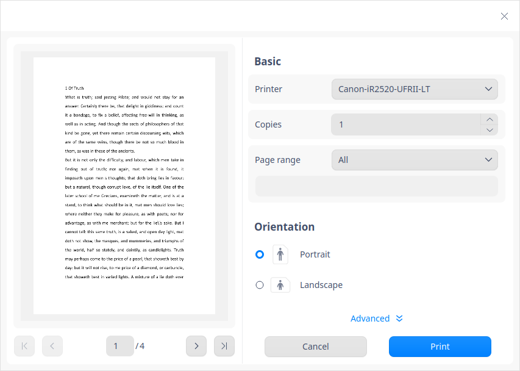

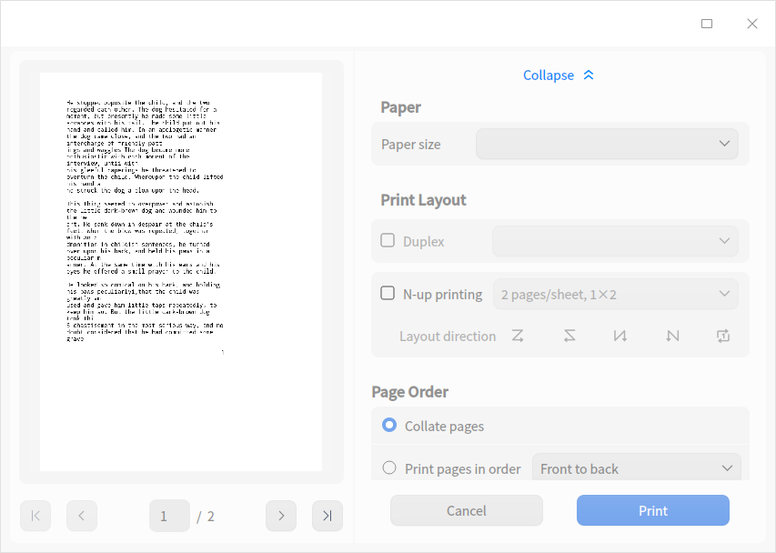

## Editing Text

### Moving the Cursor

Apart from using arrow keys and mouse clicks, you can use the following shortcuts for efficient navigation:

| Function                                   | Shortcut           |
| ------------------------------------------ | ------------------ |
| Save cursor position                       | Ctrl + Shift + >   |
| Reset cursor position (jump to last saved) | Ctrl + Shift + <   |
| Move right one word                        | Ctrl + Right Arrow |
| Move left one word                         | Ctrl + Left Arrow  |
| Move to line end                           | End                |
| Move to line start                         | Home               |
| Move to document end                       | Ctrl + End         |
| Move to document start                     | Ctrl + Home        |
| Move to indentation                        | Ctrl + M           |
| Right bracket matching (jump after )       | Alt + P            |
| Left bracket matching (jump before ()      | Alt + N            |

### Toggling Case

The case toggling feature allows you to convert selected text to uppercase, lowercase, or capitalize the first letter.

1. Select the text to modify.
2. Right-click and choose **Toggle Case**.
3. Select **Uppercase**/**Lowercase**/**Capitalize**; changes take effect immediately.

You can also use the shortcuts **Alt + U/L/C** for quick case toggling.

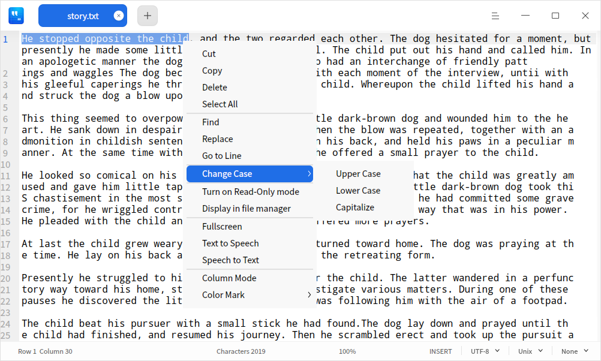

### Highlighting Text

The Text Editor supports highlighting text of various types. Click the triangle icon at the bottom-right of the status bar and select a text type. Relevant content will be highlighted automatically.

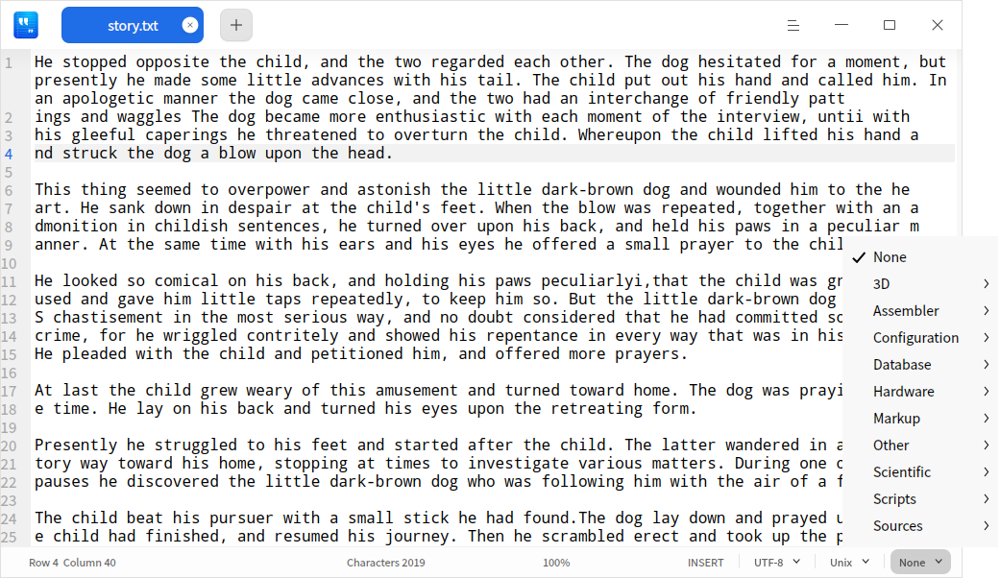

### Deleting Text

In addition to deleting characters one by one, you can use these shortcuts for faster deletion:

| Function            | Shortcut         |
| ------------------- | ---------------- |
| Delete to line end  | Ctrl + K         |
| Delete current line | Ctrl + Shift + K |
| Delete left word    | Alt + Shift + N  |
| Delete right word   | Alt + Shift + M  |

### Undoing Actions

If you make a mistake while editing, use **Ctrl + Z** or right-click and select **Undo**.

### Finding Text

1. Click  > **Find**, or use **Ctrl + F** to open the Find window.
2. Enter the text to search.
3. Click **Next** or **Previous**, or press **Enter** to find the next match.
4. Press **Esc** or click the close button to exit.

>  Tip: If you select text before searching, it will automatically populate the Find window.

### Replacing Text

1. Click  > **Replace**, or use **Ctrl + H**, or click **Replace** in the Find window.
2. Enter the text to replace and the new text.
3. Click **Replace** for individual changes, **Replace All** for all matches, or **Skip** to ignore the current match.
4. Press **Esc** or click the close button to exit.

### Jumping to a Line

Use this feature to quickly navigate to any line. Right-click and select **Go to Line**, or use **Ctrl + G**, then enter the line number.

### Editing Lines

Use these shortcuts for efficient line editing:

| Function                         | Shortcut             |
| -------------------------------- | -------------------- |
| Insert line above                | Ctrl + Enter         |
| Insert line below                | Ctrl + Shift + Enter |
| Duplicate current line           | Ctrl + Shift + D     |
| Move line up (swap with above)   | Ctrl + Shift + Up    |
| Move line down (swap with below) | Ctrl + Shift + Down  |
| Scroll line up                   | Super + Shift + Up   |
| Scroll line down                 | Super + Shift + Down |
| Set marker                       | Alt + H              |
| Clear marker                     | Alt + Shift + H      |
| Copy line                        | Super + C            |
| Cut line                         | Super + X            |
| Merge lines                      | Ctrl + J             |

### Changing View Mode

After opening a document, right-click and select **View Mode**, then choose from the submenu:

1. **Edit View**: Free editing of text.
2. **Read-Only View**: View text only; no editing.
3. **Live Preview**: For Markdown files. Edit on the left while previewing on the right.

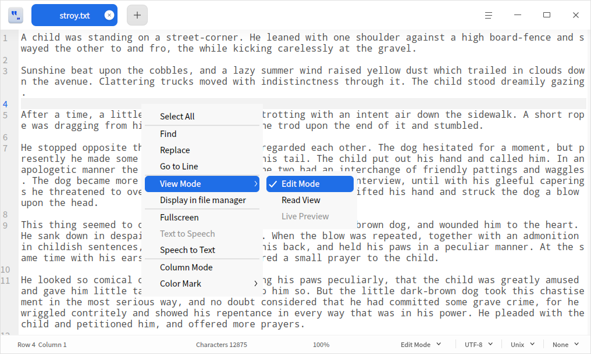

### Text-to-Speech

1. Select text, right-click, and choose **Text-to-Speech** to hear the selection read aloud.
2. Click the close button on the speech control to stop.

>  Note: **Text-to-Speech** is disabled (grayed out) if no text is selected.

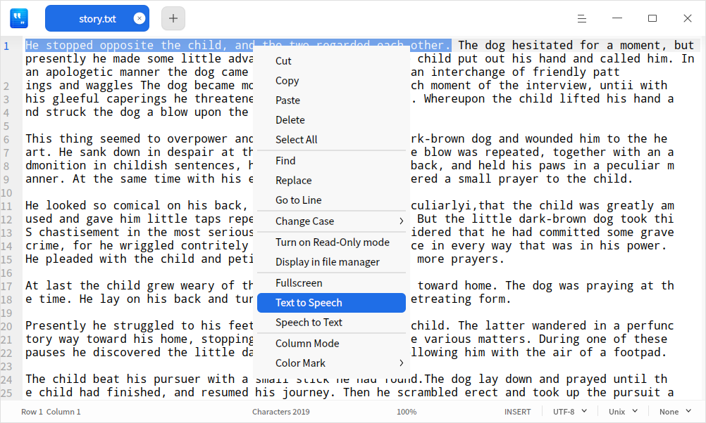

### Speech-to-Text

1. In the text area, right-click and select **Speech-to-Text**; spoken words will be transcribed and inserted at the cursor.
2. Click the close button to stop transcription.

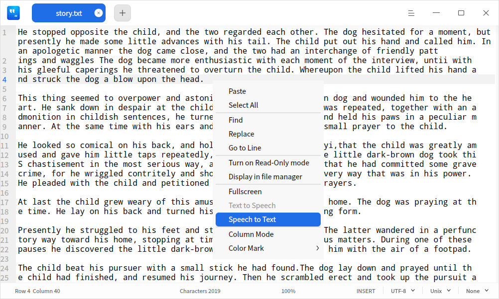

### Column Editing

Hold **Alt**, then left-click multiple columns to enter column edit mode, allowing simultaneous edits for multiple lines of code.

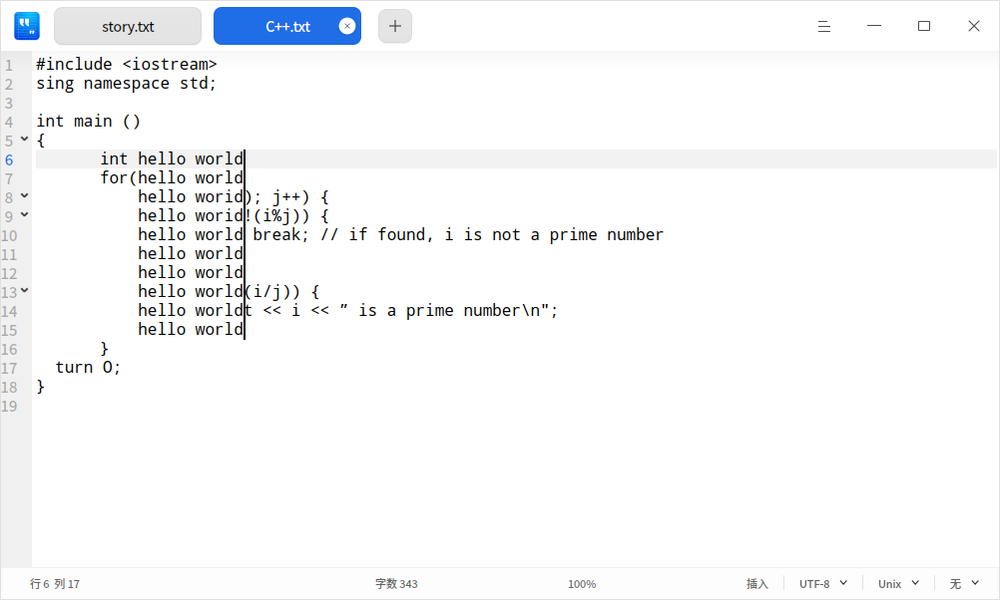

### Color Marking

Right-click and select **Color Marking**, then:

- **Add Mark**: Mark a line or selected text with one of 8 colors.
- **Mark All**: Highlight all matching text in the document.
- **Clear Last**: Remove the last mark.
- **Clear All**: Remove all marks.

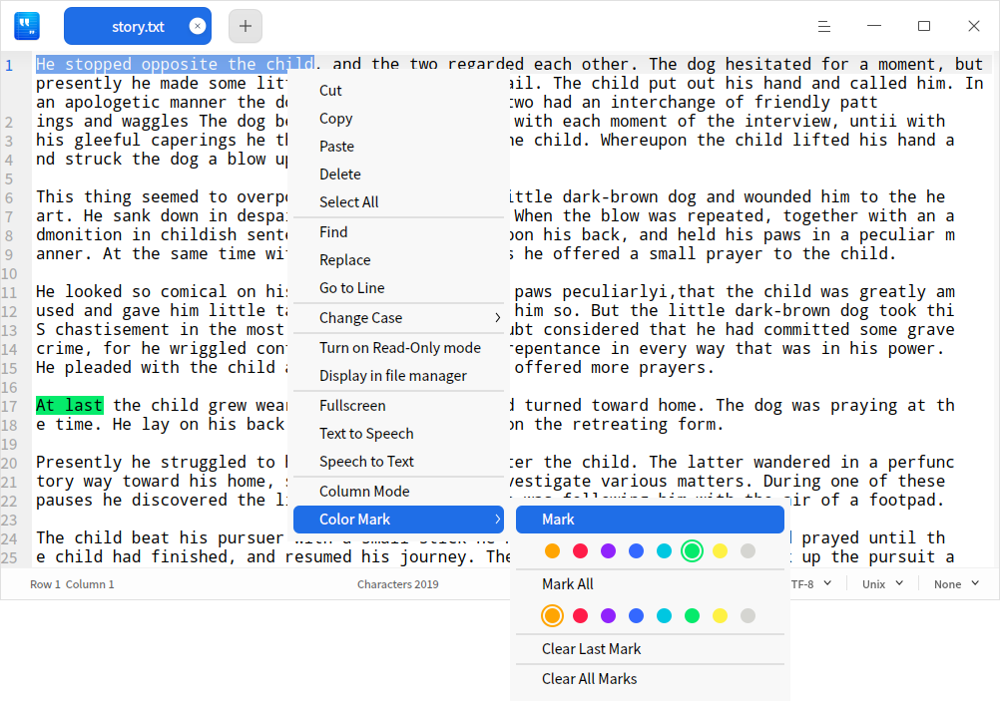

### Bookmark Management

Enable **Show Bookmark Icon** in settings to add bookmarks. Hover over line numbers in the left margin to see ;  indicates a bookmark.

- **Add Bookmark**:
  - Click  or right-click and select **Add Bookmark**.
  - Use **Ctrl + F2**.
- **Remove Bookmark**:
  - Click , right-click and select **Clear Bookmark**, or **Clear All**.

>  Note: Bookmark icons appear only when hovering.

### Comment Management

For code files (e.g., `.cpp`, `.java`, `.py`):

- **Add Comment**:
  - Select text, right-click, and choose **Add Comment** or use **Alt + A**.
- **Remove Comment**:
  - Select commented text, right-click, and choose **Remove Comment** or use **Alt + Z**.

>  Note: Supports language-specific comment symbols (e.g., `//` for C/Java, `#` for Python).

## Main Menu

The main menu allows you to create new windows/tabs, find/replace text, save files, switch themes, view help, and more.

### Settings

Configure basic, shortcut, and advanced settings.

#### Basic Settings

1. Click  > **Settings**.
2. Options:
   - Font style and size.
   - **Word Wrap**: Enable automatic line breaks.
   - **Code Folding Icons**: Show  or  for folding/expanding code blocks.
   - **Show Line Numbers**: Display line numbers.
   - **Highlight Current Line**: Highlight the active line.
   - **Show Bookmark Icons**: Display bookmarks.
   - **Show Whitespace/Tabs**: Visualize whitespace characters.

>  Tip: Use **Ctrl + +/-** to adjust font size; **Ctrl + 0** resets it.

#### Shortcut Settings

1. Click  > **Settings** > **Shortcuts**.
2. Choose a preset or customize shortcuts.

#### Advanced Settings

Configure window state (normal, maximized, fullscreen) and tab character width.

### Theme

Switch between light, dark, and system themes via  > **Theme**.

### Help

View the manual via  > **Help**.

### About

Check the version and description via  > **About**.

### Exit

Quit the application via  > **Exit**.

---

### **Technical Analysis**

**【Technical Terms and Concepts】**

1. **Syntax Highlighting**:
   - **Definition**: A feature that displays text (especially code) in distinct colors and fonts to distinguish different elements (e.g., keywords, strings, comments).
   - **Application**: Enhances code readability and debugging efficiency.

2. **Code Folding**:
   - **Definition**: A feature that collapses blocks of code (e.g., functions, loops) to simplify navigation in large files.
   - **Implementation**: Supported via icons in the left margin (e.g., ).

3. **Column Editing**:
   - **Definition**: Simultaneous editing of aligned text across multiple lines, often used for bulk data/code manipulation.
   - **Usage**: Activated by holding **Alt** while selecting columns.

4. **Text-to-Speech/Speech-to-Text**:
   - **Technologies**: Likely leverages system APIs for voice synthesis (TTS) and recognition (STT).
   - **Dependencies**: Requires microphone access for STT.

5. **Markdown Live Preview**:
   - **Definition**: A split-view mode that renders Markdown in real-time as it is edited.
   - **Tools**: Typically involves a lightweight Markdown parser integrated into the editor.

6. **Bookmark Management**:
   - **Purpose**: Allows users to mark specific lines for quick navigation, especially in long documents.
   - **Visual Cues**: Icons (e.g., ) indicate bookmarked lines.

**【Key Shortcuts】**
- **Navigation**: `Ctrl + Arrow Keys` for word-wise movement; `End`/`Home` for line-wise.
- **Editing**: `Ctrl + Shift + D` duplicates lines; `Ctrl + J` merges lines.
- **Efficiency**: `Alt + U/L/C` for case toggling, `Ctrl + K` for deletion.

**【Target Audience】**
- Developers: Features like syntax highlighting, code folding, and comment management cater to coding.
- General Users: Simple text editing, printing, and TTS/STT support broader use cases.

**【Integration】**
- **System-Level**: Printer configuration, theme synchronization (light/dark mode), and default app associations.