# Editor de Textos|deepin-editor|

## Visão Geral

O Editor de Textos é uma ferramenta simples de edição de texto. Você pode usá-lo para escrever documentos de texto simples, bem como aproveitar seus recursos avançados para transformá-lo em uma ferramenta de edição de código, com suporte a destaque de sintaxe.

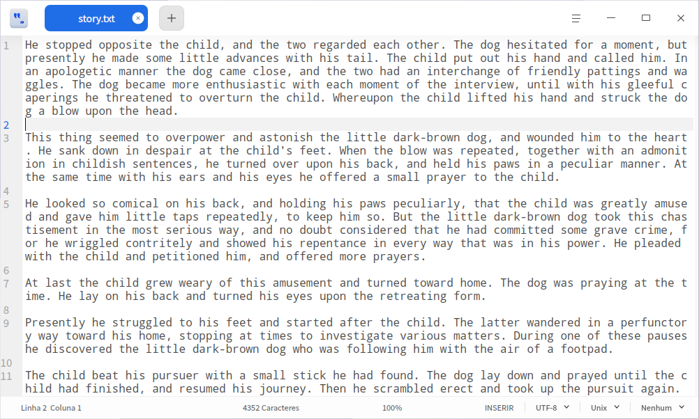

## Introdução ao Uso

### Executar o Editor de Textos

1. Clique no ícone do launcher na barra de tarefas  para acessar a interface do launcher.
2. Role a roda de scroll do mouse para navegar ou use a busca para encontrar o ícone do Editor de Textos  e clique para executar.
3. Clique com o botão direito no ícone , você pode:

 - Clicar em **Enviar para a Mesa de Trabalho** para criar um atalho na mesa de trabalho.
 - Clicar em **Enviar para a Barra de Tarefas** para fixar o aplicativo na barra de tarefas.
 - Clicar em **Iniciar com o Sistema** para adicionar o aplicativo à lista de inicialização, fazendo com que ele seja executado automaticamente ao ligar o computador.

### Sair do Editor de Textos

- Na interface do Editor de Textos, clique em  para sair do Editor de Textos.
- Na interface do Editor de Textos, clique no menu principal  > **Sair** para sair do Editor de Textos.
- Na barra de tarefas, clique com o botão direito em  e selecione **Fechar Todos** para sair do Editor de Textos.

### Visualizar Atalhos

Na interface do Editor de Textos, use o atalho **Ctrl + Shift + ?** para abrir a interface de visualização de atalhos; você também pode visualizar os atalhos na interface de configurações. O uso hábil dos atalhos aumentará consideravelmente a eficiência das suas operações.

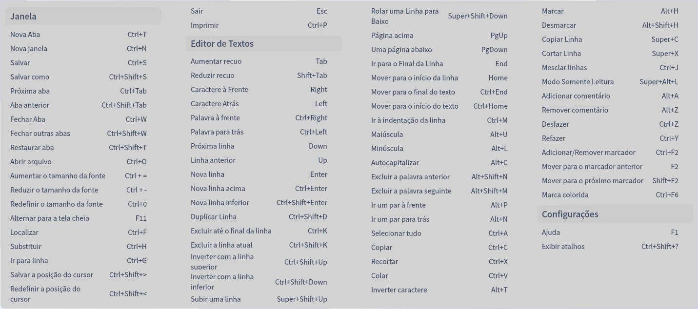

## Operações Básicas

### Gerenciar Abas

- Nova aba/janela

  - Clique no botão  da aba, ou em  > **Nova Aba**, ou use o atalho **Ctrl + T** para criar uma nova aba.
  - Clique em  > **Nova Janela** ou use o atalho **Ctrl + N** para criar uma nova janela.

- Reorganizar abas/janelas

  - Arraste as abas dentro da mesma janela para reordená-las.
  - Role a roda do mouse para alternar entre as abas da mesma janela.
  - Retire uma aba para criar uma nova janela, ou mova-a de uma janela para outra.

- Fechar abas/janelas

  Quando a janela tiver apenas uma aba, fechar a aba também fechará a janela.

  - Use o atalho **Ctrl + W** para fechar a aba atual.
  - Clique no botão  da aba ou clique com o botão do meio do mouse para fechar a aba atual.
  - Clique com o botão direito na aba e selecione **Fechar Aba**, **Fechar Outras Abas** ou **Mais Formas de Fechar** para fechar abas.

  > Observação: se o seu arquivo foi alterado e não foi salvo, o Editor de Textos solicitará que você salve as alterações antes de fechar.

### Abrir Arquivo

Você pode abrir um ou vários arquivos de texto simultaneamente das seguintes maneiras; os arquivos selecionados serão abertos em novas abas:

- Arraste diretamente o arquivo para a interface do Editor de Textos ou sobre o seu ícone.
- Clique com o botão direito no arquivo e selecione **Abrir Com** > **Editor de Textos**. Após definir o Editor de Textos como programa padrão de abertura, basta dar um duplo clique para abrir.
- Na interface do Editor de Textos, clique em  > **Abrir Arquivo** ou use o atalho **Ctrl + O** e, na janela exibida, selecione o arquivo a abrir.

### Salvar Arquivo

- Clique em  > **Salvar** ou use o atalho **Ctrl + S** para salvar o arquivo atual.
- Clique em  > **Salvar Como** ou use o atalho **Ctrl + Shift + S** para salvar o arquivo atual com outro nome.

### Imprimir Arquivo

Para usar a impressão no Editor de Textos, é necessário conectar e configurar previamente a impressora.

1. Clique em  > **Imprimir** ou use o atalho **Ctrl + P** para abrir a visualização de impressão.
2. Na interface de visualização de impressão, você pode visualizar o arquivo, selecionar a impressora e configurar a página de impressão.
3. Na interface de visualização de impressão, clique em **Configurações Avançadas** para configurar parâmetros como o tamanho do papel, o método de impressão, entre outros.
4. Clique em **Imprimir** para enviar o arquivo para a impressora.

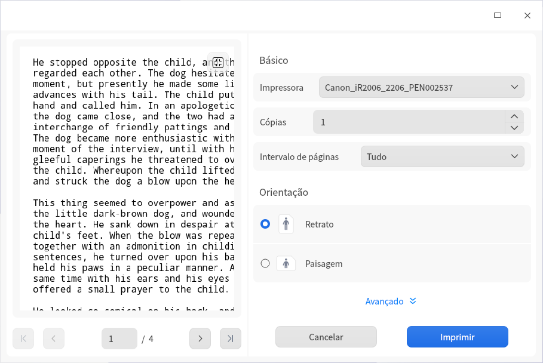

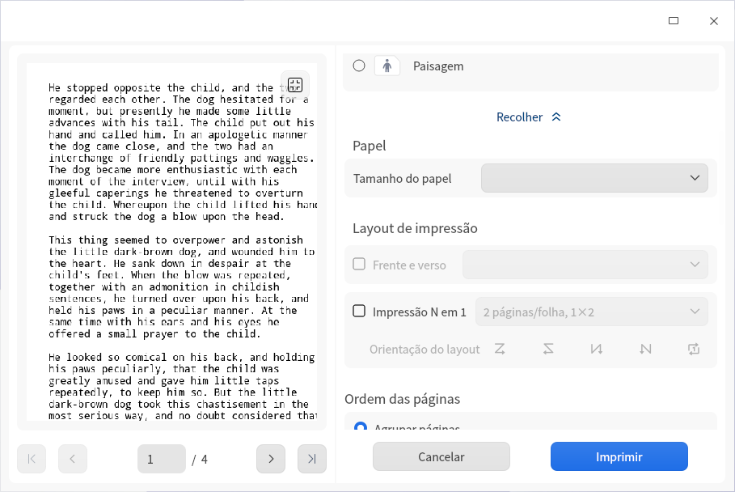

## Editar Texto

### Mover o Cursor

Além de usar as teclas de direção e o clique do mouse para mover o cursor, você também pode usar os seguintes atalhos para movê-lo rapidamente:

| Função                                                       | Atalho                |
| ------------------------------------------------------------ | --------------------- |
| Salvar a posição do cursor                                   | Ctrl + Shift + >      |
| Restaurar a posição do cursor (pular para a última posição salva) | Ctrl + Shift + <      |
| Mover uma palavra para a direita (o cursor salta uma palavra à direita) | Ctrl + tecla direita  |
| Mover uma palavra para a esquerda (o cursor salta uma palavra à esquerda) | Ctrl + tecla esquerda |
| Mover para o fim da linha                                    | End                   |
| Mover para o início da linha                                 | Home                  |
| Mover para o fim do texto                                    | Ctrl + End            |
| Mover para o início do texto                                 | Ctrl + Home           |
| Mover para a indentação da linha                             | Ctrl + M              |
| Correspondência à direita (o cursor move para depois do parêntese de fechamento) | Alt + P               |
| Correspondência à esquerda (o cursor move para antes do parêntese de abertura) | Alt + N               |

### Alternar Maiúsculas/Minúsculas

A função de alternância de maiúsculas/minúsculas permite converter todo o texto selecionado em letras maiúsculas, letras minúsculas ou com a primeira letra de cada palavra em maiúscula.

1. Selecione o conteúdo de texto a ser alterado.
2. Clique com o botão direito e selecione **Alternar Maiúsculas/Minúsculas**.
3. Selecione a opção **MAIÚSCULAS**/**minúsculas**/**Primeira Letra Maiúscula**; a alteração entra em vigor imediatamente.

Você também pode usar os atalhos **Alt + U / L / C** para alternar rapidamente entre maiúsculas e minúsculas.

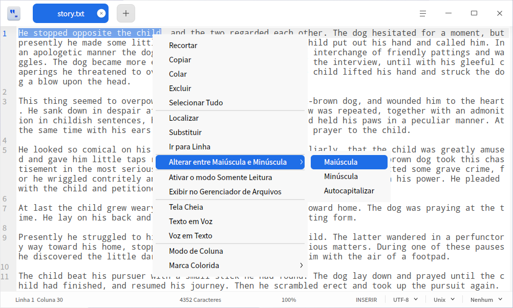

### Destacar Texto

O Editor de Textos suporta o destaque de diferentes tipos de texto.
Clique no símbolo triangular na extremidade direita da barra de status inferior e selecione um tipo de texto. Se o texto contiver o conteúdo correspondente, ele será destacado automaticamente.

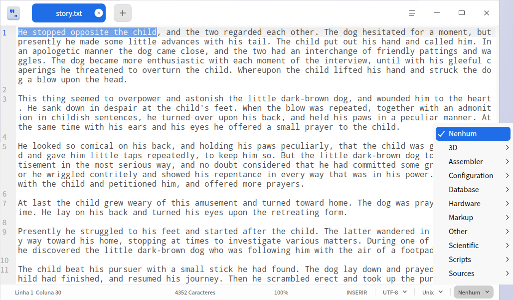

### Excluir Texto

Além de excluir caractere por caractere para a esquerda ou para a direita, você também pode usar os seguintes atalhos para excluir caracteres rapidamente:

| Função                         | Atalho           |
| ------------------------------ | ---------------- |
| Excluir até o fim da linha     | Ctrl + K         |
| Excluir a linha atual          | Ctrl + Shift + K |
| Excluir uma palavra à esquerda | Alt + Shift + N  |
| Excluir uma palavra à direita  | Alt + Shift + M  |

### Desfazer Operação

Se ocorrer uma operação incorreta durante a edição do texto, você pode usar o atalho **Ctrl + Z** para desfazer a operação, ou selecionar **Desfazer** no menu de contexto.

### Localizar Texto

1. Clique em  > **Localizar** ou use o atalho **Ctrl + F** para abrir a janela de localização.
2. Na janela de localização, digite o texto a ser pesquisado.
3. Clique em **Próximo** e **Anterior** para localizar uma ocorrência por vez, ou use a tecla **Enter** para localizar a próxima ocorrência.
4. Pressione a tecla **Esc** ou clique no botão de fechar para fechar a janela de localização.

> Dica: se você selecionar um trecho de texto antes de localizar, esse trecho aparecerá automaticamente na janela de localização.

### Substituir Texto

1. Clique em  > **Substituir**, ou use o atalho **Ctrl + H**, ou clique em **Substituir** na janela de localização para abrir a janela de substituição.
2. Na janela de substituição, digite o texto a ser substituído e o novo texto.
3. Clique em **Substituir** para substituir uma ocorrência por vez; clique em **Substituir Restantes** ou **Substituir Tudo** para substituir de uma vez as ocorrências restantes ou todas as ocorrências; clique em **Pular** para não substituir a ocorrência atual.
4. Pressione a tecla **Esc** ou clique no botão de fechar para fechar a janela de busca.

### Ir para a Linha

Use esta função para pular rapidamente para qualquer linha.
No menu de contexto, selecione **Ir para a Linha** ou use o atalho **Ctrl + G** e digite o número da linha para pular até ela.

### Editar Linha

Você pode usar os seguintes atalhos para editar linhas rapidamente:

| Função                                                       | Atalho               |
| ------------------------------------------------------------ | -------------------- |
| Inserir uma linha acima (inserir uma linha acima)            | Ctrl + Enter         |
| Inserir uma linha abaixo (inserir uma linha abaixo)          | Ctrl + Shift + Enter |
| Copiar e colar a linha atual                                 | Ctrl + Shift + D     |
| Mover uma linha para cima (trocar de posição com a linha anterior) | Ctrl + Shift + Up    |
| Mover uma linha para baixo (trocar de posição com a linha seguinte) | Ctrl + Shift + Down  |
| Rolar uma linha para cima                                    | Super + Shift + Up   |
| Rolar uma linha para baixo                                   | Super + Shift + Down |
| Definir marcador                                             | Alt + H              |
| Remover marcador                                             | Alt + Shift + H      |
| Copiar linha                                                 | Super + C            |
| Recortar linha                                               | Super + X            |
| Mesclar linhas                                               | Ctrl + J             |

### Ativar/Desativar o Modo Somente Leitura

1. Abra um documento no Editor de Textos, clique com o botão direito e selecione **Ativar Modo Somente Leitura**.
2. No modo somente leitura, clique com o botão direito e selecione **Desativar Modo Somente Leitura**.

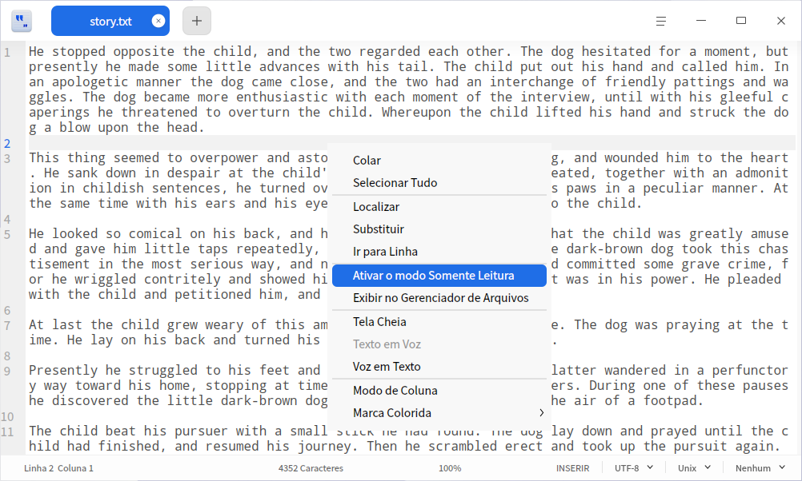

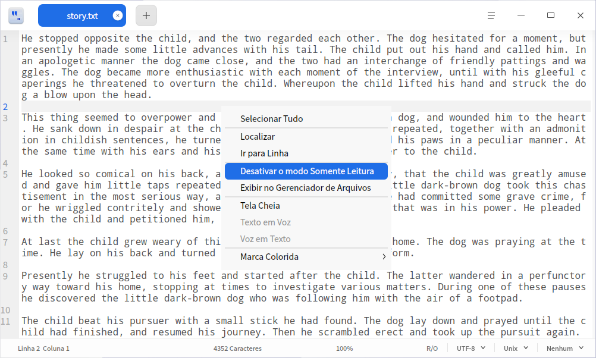

### Leitura em Voz Alta

1. Selecione um trecho de texto, clique com o botão direito e selecione **Leitura em Voz Alta**; o trecho selecionado será lido em voz alta.

2. Durante a leitura, clique no botão de fechar do controle de leitura para encerrá-la.

   > Observação: quando nenhum texto estiver selecionado, a opção **Leitura em Voz Alta** do menu de contexto ficará desativada, exibida em cinza.

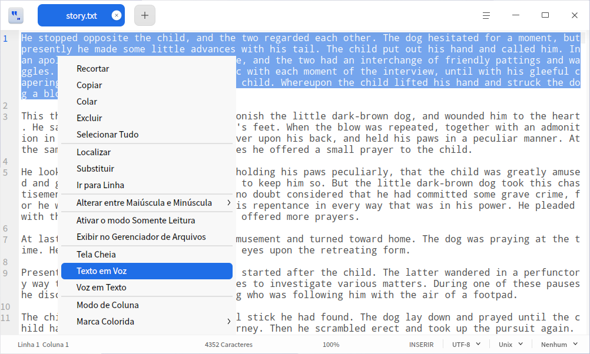

### Ditado por Voz

1. Na área de edição de texto, clique com o botão direito e selecione **Ditado por Voz**; fale ao microfone e o texto transcrito será inserido na posição do cursor.

2. No modo de ditado, clique no botão de fechar do controle de ditado para interromper o ditado por voz.

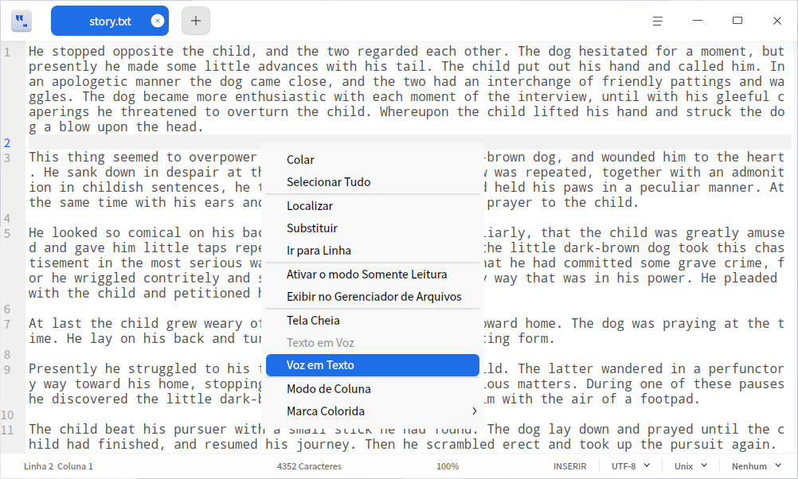

### Edição em Coluna

Na interface do Editor de Textos, mantenha a tecla **Alt** pressionada e clique com o botão esquerdo do mouse em várias colunas para ativar o modo de edição em coluna, permitindo editar simultaneamente o mesmo conteúdo em várias linhas de código e aumentando a eficiência do trabalho.

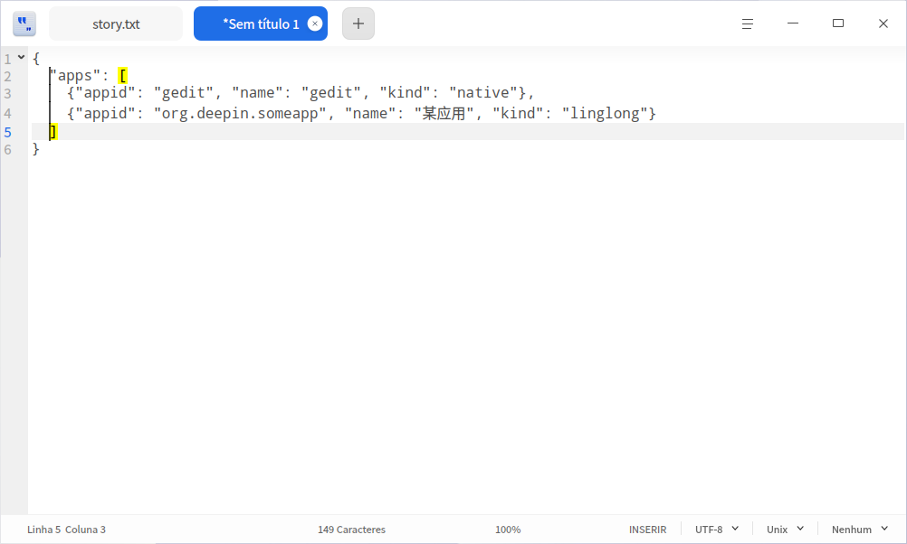

### Marcação por Cor

Na interface do Editor de Textos, clique com o botão direito e selecione **Marcação por Cor**; faça a escolha na lista suspensa.

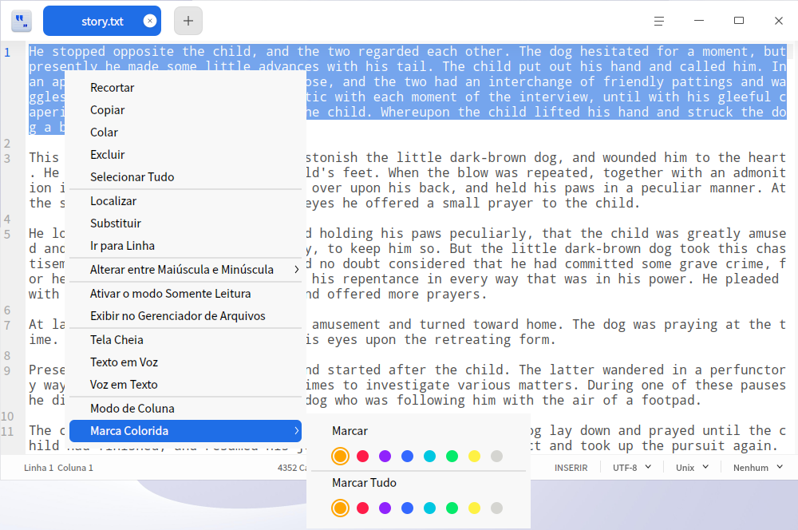

   - **Adicionar Marcação**: adiciona uma marcação de cor a uma linha ou a um trecho de texto; há 8 botões de cores disponíveis.
     + Posicione o cursor em uma linha para marcar a linha atual.
     + Selecione um trecho de texto para marcar o conteúdo selecionado.
   - **Marcar Tudo**: marca todo o conteúdo do texto ou, a partir do texto selecionado, marca as ocorrências correspondentes em todo o documento; há 8 botões de cores disponíveis.
     + Posicione o cursor em qualquer linha para marcar todo o conteúdo do texto.
     + Selecione um trecho de texto para marcar as ocorrências correspondentes em todo o documento.

   - **Limpar Última Marcação**: remove a última marcação realizada.
   - **Limpar Todas as Marcações**: remove todas as marcações atuais.

### Gerenciamento de Marcadores

Na interface de configurações do Editor de Textos, após marcar **Exibir ícone de marcador**, você pode adicionar marcadores ao conteúdo de qualquer linha do texto. Ao passar o ponteiro do mouse sobre qualquer número de linha na barra lateral esquerda, o ícone  será exibido; após a adição, o ícone de marcador dessa linha passará a ser um ícone preenchido em azul .

- Adicionar marcador

  + Clique com o botão esquerdo do mouse em  para adicionar um marcador a essa linha.
  + Clique com o botão direito do mouse em  e selecione **Adicionar Marcador** para adicionar um marcador a essa linha.
  + Posicione o cursor em qualquer linha do texto e use o atalho **Ctrl + F2** para adicionar um marcador a essa linha.

- Excluir marcador

  + Clique com o botão esquerdo do mouse no ícone de marcador já preenchido para excluir diretamente o marcador dessa linha.
  + Clique com o botão direito do mouse no ícone de marcador já preenchido e selecione **Remover Marcador** para excluir o marcador dessa linha.
  + Clique com o botão direito do mouse no ícone de marcador e selecione **Remover Todos os Marcadores** para excluir todos os marcadores do texto.

   >Observação: o ícone de marcador só é exibido quando o mouse está sobre o número da linha na barra lateral esquerda; ao sair da área de marcadores, o ícone desaparece. Após adicionar um marcador, o ícone permanece sempre visível.

### Gerenciamento de Comentários

Na interface do Editor de Textos, você pode adicionar comentários em arquivos de código com extensões como .cpp, .java, .py, entre outras.

- Adicionar comentário

  + Selecione um trecho de texto, clique com o botão direito e selecione **Adicionar Comentário**.
  + Selecione um trecho de texto e use o atalho **Alt + A** para adicionar um comentário.

- Remover comentário

  + Selecione um trecho de texto que já contenha comentários, clique com o botão direito e selecione **Remover Comentário**.
  + Selecione um trecho de texto que já contenha comentários e use o atalho **Alt + Z** para remover o comentário.

  >Observação: há suporte a comentários de diferentes linguagens de código, conforme a situação real. Por exemplo, os símbolos de comentário de C, C# e Java são //, e o símbolo de comentário de Python é #.

## Menu Principal

No menu principal, você pode criar novas janelas, criar novas abas, [localizar texto](#localizar-texto), [substituir texto](#substituir-texto), salvar arquivos, alternar o tema da janela, visualizar o manual de ajuda e conhecer mais informações sobre o Editor de Textos.

### Configurações

Você pode configurar as informações básicas, os atalhos e as informações avançadas.

#### Configurações Básicas

1. Clique em  > **Configurações**.
2. Na opção de configurações básicas, você pode escolher:

 - Definir o estilo e o tamanho da fonte.

 - Marcar **Quebra Automática de Linha** para quebrar linhas automaticamente na área de edição.

 - Marcar **Indicador de Dobra de Código** para exibir na barra lateral esquerda os botões  ou ; clique com o botão direito no botão e selecione dobrar/expandir o nível atual ou todos os níveis.

 - Marcar **Exibir Números de Linha** para exibir os números de linha na barra lateral esquerda.

 - Marcar **Realçar a Linha Atual** para destacar a linha em que o cursor está posicionado.

 - Marcar **Exibir Ícone de Marcador** para exibir os ícones de marcador na barra lateral esquerda.

 - Marcar **Exibir Caracteres em Branco/Tabulações** para exibir os caracteres em branco e as tabulações do texto; você também pode inserir ou excluir manualmente caracteres em branco e tabulações.

   > Dica: no Editor de Textos, use **Ctrl + "+"/"-"** para ajustar o tamanho da fonte e **Ctrl + 0** para restaurar o tamanho padrão.

#### Configurações de Atalhos

1. Clique em  > **Configurações** e consulte os atalhos atuais na opção **Atalhos**.

2. Selecione um mapeamento de atalhos.

3. Você pode clicar na área de edição de atalhos para personalizar os atalhos.

   > Observação: o mapeamento de atalhos permite escolher um conjunto de atalhos de teclado. Você pode usar atalhos padrão, atalhos do Emacs ou atalhos personalizados, de acordo com seu hábito de uso.

#### Configurações Avançadas

1. Clique em  > **Configurações**.
2. Na opção **Configurações Avançadas**, você pode definir:
   - Estado da janela: janela normal, maximizada ou tela cheia.
   - Largura do caractere Tab: o espaço ocupado pela indentação com Tab.

### Tema

O tema da janela inclui o tema claro, o tema escuro e o tema do sistema.

1. Na interface do Editor de Textos, clique em .
2. Selecione **Tema** e escolha uma cor de tema.

### Ajuda

Visualize o manual de ajuda para conhecer e usar melhor o Editor de Textos.

1. Na interface do Editor de Textos, clique em .
2. Selecione **Ajuda**.
3. Visualize o manual de ajuda do Editor de Textos.

### Sobre

1. Na interface do Editor de Textos, clique em .
2. Selecione **Sobre**.
3. Visualize a versão e a apresentação do Editor de Textos.

### Sair

1. Na interface do Editor de Textos, clique em .
2. Selecione **Sair**.
