# 文本编辑器|deepin-editor|

## 概述

文本编辑器是一个简单的文本编辑工具。您可以用它书写简单的文本文档，也可以使用它的高级特性，让它成为一个代码编辑工具，支持代码语法高亮。

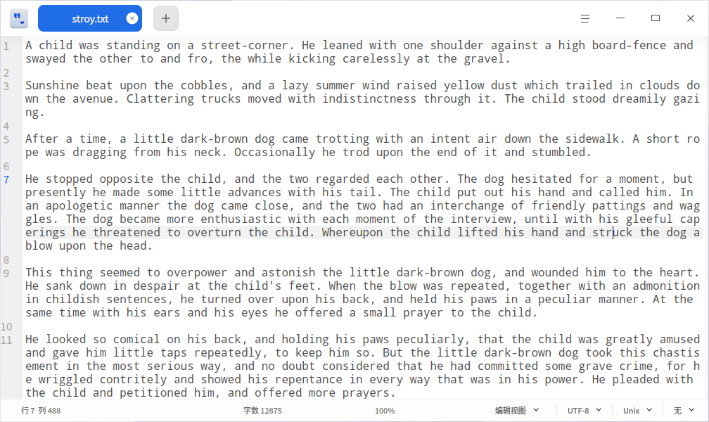

> 说明：部分版本和机型功能可能存在差异，具体以实际功能为准。

## 使用入门

### 运行文本编辑器

1. 单击任务栏上的启动器图标 ，进入启动器界面。
2. 上下滚动鼠标滚轮浏览或通过搜索，找到文本编辑器图标 ，单击运行。
3. 右键单击，您可以：

 - 单击 **发送到桌面**，在桌面创建快捷方式。
 - 单击 **发送到任务栏**，将应用程序固定到任务栏。
 - 单击 **开机自动启动**，将应用程序添加到开机启动项，在电脑开机时自动运行该应用。

> 说明：勾选设置中的 **保留关闭前的页签** 后，重新启动文本编辑器会自动恢复上次关闭时打开的标签页。

### 退出文本编辑器

- 在文本编辑器界面，单击 ，退出文本编辑器。
- 在文本编辑器界面，单击主菜单  > **退出** ，退出文本编辑器。
- 在任务栏右键单击 ，选择 **关闭所有** ，退出文本编辑器。

### 查看快捷键

在文本编辑器界面，使用快捷键 **Ctrl + Shift + ?** 打开快捷键预览界面，您也可以在设置界面查看快捷键。熟练地使用快捷键，将大大提升您的操作效率。

## 基本操作

### 管理标签页

- 新建标签页/窗口

   - 单击标签页上的按钮  或  > **新标签页** 或使用快捷键 **Ctrl + T** 创建一个新的标签页。
   - 单击 > **新窗口** 或使用快捷键 **Ctrl + N** 创建一个新的窗口。

- 调整标签页/窗口

   - 拖拽同一窗口内的标签页重新排序。
   - 滚动鼠标切换同一窗口内的标签页。
   - 移出标签页创建一个新的窗口，或者从一个窗口移到另外一个窗口中。

- 关闭标签页/窗口

   当窗口中仅有一个标签页时，关闭标签页的同时也会关闭窗口。
   - 使用快捷键 **Ctrl + W** 关闭当前标签页。
   - 单击标签页上的按钮  或者单击鼠标中键，关闭当前标签页。
   - 右键单击标签页，选择 **关闭标签页** 、**关闭其他标签页** 或 **更多关闭方式** 来关闭标签页。

   > 说明：如果您的文件发生了变化而没有保存，文本编辑器会在关闭前提示您保存更改。

### 打开文件

您可以采用以下方式打开一个或同时打开多个文本文件，选中的文件将会在新标签页打开：

- 直接拖动文件到文本编辑器界面或其图标上。
- 右键单击文件，选择 **打开方式** > **文本编辑器**。选择文本编辑器为默认打开程序后，可直接双击打开。
- 在文本编辑器界面，单击  > **打开文件** 或使用快捷键 **Ctrl + O**，在弹出的窗口中选择文件。

  

### 保存文件
- 单击  > **保存** 或使用快捷键 **Ctrl + S**，保存当前文件。
- 单击  > **另存为** 或使用快捷键 **Ctrl + Shift + S**，另存当前文件。在另存为窗口中，您还可以设置文件名、保存位置和文件编码。

> 说明：当文件编码发生变化、磁盘中的原文件已被移除或当前用户没有保存权限时，文本编辑器会在保存过程中给出相应提示，您可以选择 **保存**、**不保存** 或 **强制保存**。

### 打印文件

在文本编辑器中使用打印，需要您连接并配置好打印机。

1. 单击  > **打印** 或使用快捷键 **Ctrl + P** 打开打印预览。
2. 在打印预览界面，您可以预览文件，选择打印机并设置打印页面。
3. 在打印预览界面，单击 **高级设置**，可配置纸张大小、打印方式等相关参数。
4. 单击 **打印** 即可将文件发送到打印机打印。

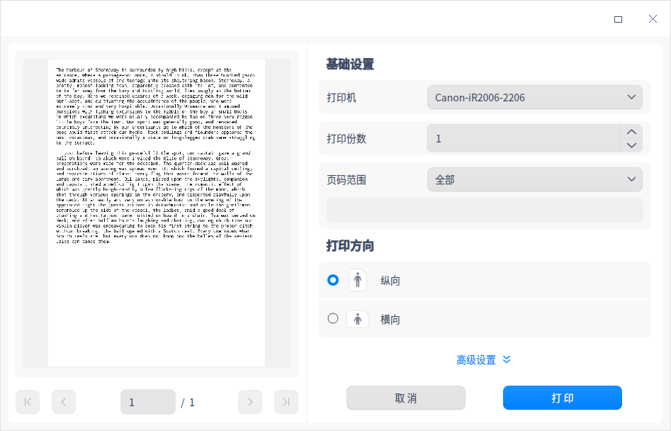

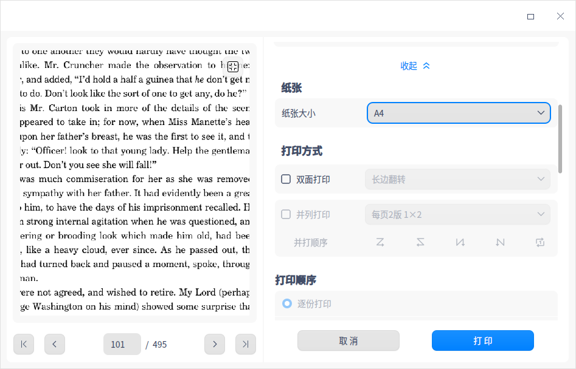

## 编辑文本

### 移动光标

除了使用方向键和鼠标点击移动光标，您还可以使用以下快捷键迅速移动光标：

| 功能   |  快捷键 |
| --------------- | ------------ |
| 保存光标位置 | Ctrl + Shift + > |
| 重置光标位置（跳转到上次光标保存的位置） | Ctrl + Shift + < |
| 右移一个字符 | 右方向键 |
| 左移一个字符 | 左方向键 |
| 右移一个词 （光标向右跳过一个词） | Ctrl + 右方向键 |
| 左移一个词 （光标向左跳过一个词） | Ctrl + 左方向键 |
| 移动到行尾 | End |
| 移动到行头 | Home |
| 移动到文本结尾 | Ctrl + End |
| 移动到文本开头 | Ctrl + Home |
| 移动到行缩进 | Ctrl + M |
| 向右匹配 （光标移动到右括号的后面） | Alt + P |
| 向左匹配（光标移动到左括号的前面） | Alt + N |

### 切换大小写

切换大小写功能可以将选中的文本全部改为大写字母、小写字母或者让首字母大写。

1. 选中待更改的文本内容。
2. 单击右键，选择 **切换大小写**。
3. 选择 **大写**/**小写**/**首字母大写** 选项，更改会立即生效。

您也可以使用快捷键 **Alt + U/ L/ C** 迅速切换大小写。

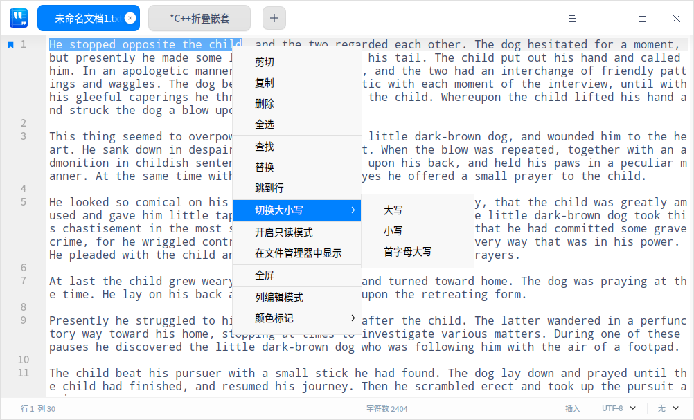

### 高亮文本

文本编辑器支持高亮不同类型的文本。
单击底部状态栏最右侧的文本类型下拉框（打开代码文件时默认按扩展名自动选择，例如 Python），选择某种文本类型。若文本中有相应内容则会自动高亮。

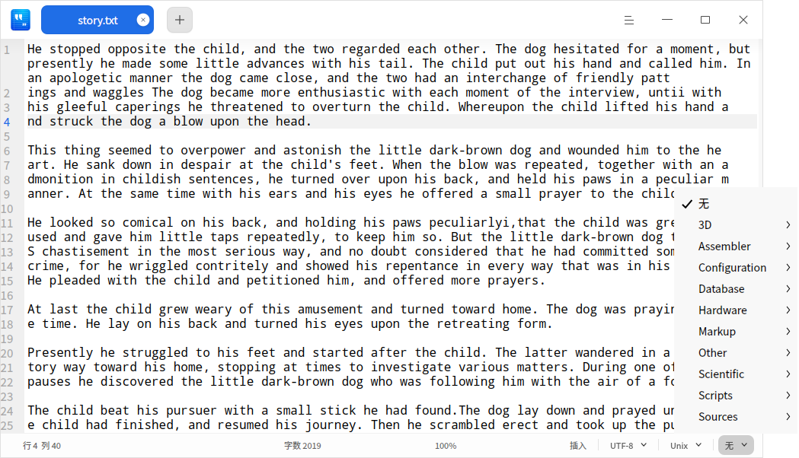

### 状态栏

编辑区底部状态栏从左到右依次显示：

| 显示项 | 说明 |
| ------------ | ------------ |
| 行 1 列 1 | 当前光标所在的行号和列号 |
| 字数 | 当前文档的字符数 |
| 100% | 当前缩放比例 |
| 插入 | 编辑模式，可在 **插入** 和 **覆盖** 之间切换 |
| UTF-8 | 当前文件编码，单击可切换编码 |
| Unix | 当前行尾符格式，单击可切换 |
| Python | 当前文本类型（语法高亮方案），单击可切换 |

### 删除文本
除了向左或向右逐个删除字符外，您还可以使用以下快捷键迅速删除字符：

| 功能   |  快捷键 |
| --------------- | ------------ |
| 删除到行尾 | Ctrl + K |
| 删除当前行 | Ctrl + Shift + K |
| 向左删除一个词 | Alt + Shift + N |
| 向右删除一个词 | Alt + Shift + M |

### 撤销与重做

如果在编辑文本时发生误操作，可以使用快捷键 **Ctrl + Z** 撤销操作，或使用快捷键 **Ctrl + Y** 重做操作。

> 说明：撤销和重做未出现在右键菜单中，请使用上述快捷键。

### 查找文本

1. 单击  > **查找** 或使用快捷键 **Ctrl + F**，打开查找窗口。
2. 在查找窗口中，输入要搜索的文本。
3. 单击 **下一个**、**上一个** 逐个查找，或使用 **Enter** 键查找下一个匹配项。
4. 按下 **Esc** 键或单击关闭按钮，关闭查找窗口。

> 窍门：选中一段文本后再进行查找，则这段文本会自动出现在查找窗口中。

### 替换文本
1. 单击  > **替换** 或使用快捷键 **Ctrl + H** ，打开替换窗口。
2. 在替换窗口中，输入要替换的文本以及新文本。
3. 单击 **替换** 逐个替换；单击 **剩余替换**、**全部替换** 一次性替换剩余的或所有的匹配文本；单击 **跳过** 不替换当前匹配的文本。
4. 按下 **Esc** 键或单击关闭按钮，关闭搜索窗口。

### 跳到行
使用该功能可以迅速跳转到任一行。
在右键菜单中选择 **跳到行** 或者使用快捷键 **Ctrl + G** ，输入行号即可跳转到相应行。

### 编辑行

您可以使用以下快捷键迅速编辑行：

| 功能   |  快捷键 |
| ------------ | ------------ |
| 向上插入一行（在上方插入一行） | Ctrl + Enter |
| 向下插入一行（在下方插入一行） | Ctrl + Shift + Enter |
| 复制并粘贴当前行 | Ctrl + Shift + D |
| 上移一行（与上一行交换位置） | Ctrl + Shift + Up |
| 下移一行（与下一行交换位置） | Ctrl + Shift + Down |
| 向上滚动一行 | Super + Shift + Up |
| 向下滚动一行 | Super + Shift + Down |
| 向上滚动一页 | Page Up |
| 向下滚动一页 | Page Down |
| 设置标记 | Alt + H |
| 取消标记 | Alt + Shift + H |
| 复制行 | Super + C |
| 剪切行 | Super + X |
| 合并行 | Ctrl + J |

### 开启/关闭只读模式

1. 使用文本编辑器打开文档，单击右键，选择 **开启只读模式**。
2. 在只读模式下，单击右键，选择 **关闭只读模式**。

您也可以使用快捷键 **Super + Alt + L** 在只读模式之间切换，切换后编辑区会提示 **只读模式已开启** 或 **只读模式已关闭**。

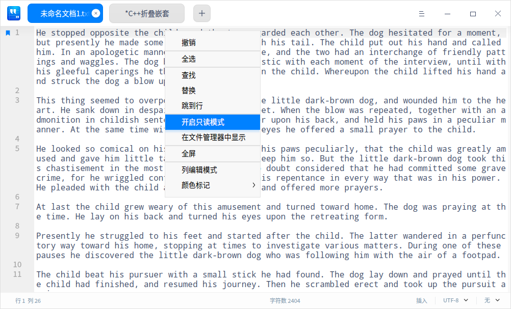

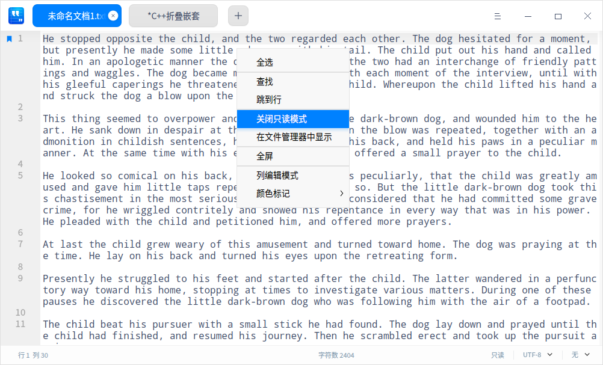

### 列编辑

在文本编辑器界面，按住 **Alt** 键不放，鼠标左键单击多列启动列编辑模式，为多行代码同时编辑相同的内容，提高工作效率。您也可以在右键菜单中选择 **列编辑模式** 进入或退出该模式。

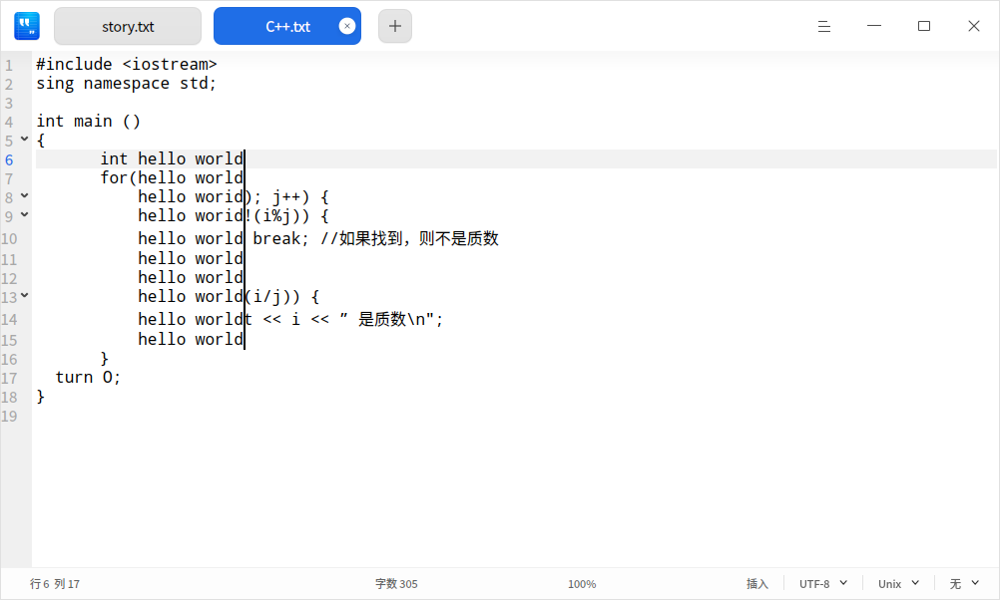

### 颜色标记

在文本编辑器界面，单击鼠标右键选择 **颜色标记**，在其下拉列表中进行选择。您也可以使用快捷键 **Ctrl + F6** 打开颜色标记菜单。

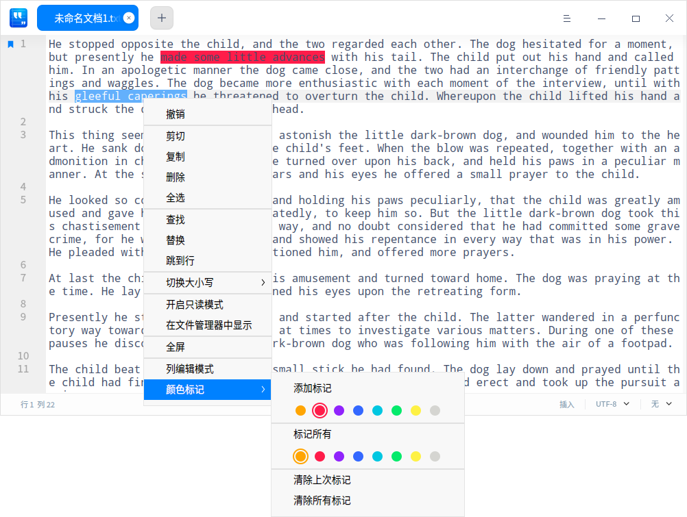

   - **添加标记**：对某一行或某一段文本内容添加颜色标记；有8种颜色按钮可供选择。
      + 将光标定在某一行，标记当前所在的行。
      + 选中一段文本内容后，标记选中的文本内容。
   - **标记所有**：将文本内容全部标记或对已选中的文本内容，在全文中标记匹配项；有8种颜色按钮可供选择。
      + 将光标定在任意一行，将文本内容全部标记。
      + 选中一段文本内容，在全文中标记匹配项。

   - **清除上次标记**：清除上次标记操作。
   - **清除所有标记**：清除当前所有标记。

### 书签管理

在文本编辑器设置界面，勾选 **显示书签图标** 后，您可以为任意一行的文本内容添加书签。将鼠标指针移至左侧栏任意行号前面会显示图标 ，添加成功后该行的书签图标会变为蓝色填充的图标 。

- 添加书签

  + 鼠标左键单击 ，为该行添加书签。
  + 鼠标右键单击 ，选择 **添加书签**，为该行添加一个书签。
  + 将光标定在文本中任意一行，使用快捷键 **Ctrl + F2** 为该行添加一个书签。

- 删除书签

  + 鼠标左键单击已填充颜色的书签图标，直接删除该行书签。
  + 鼠标右键单击已填充颜色的书签图标，选择 **清除书签**，删除该行书签。
  + 鼠标右键单击书签图标，选择 **清除所有书签**，删除该文本的全部书签。

- 跳转书签

  + 使用快捷键 **Shift + F2** 跳转到下一个书签。

   >说明：鼠标移到左侧行号前面才会显示书签图标，移出书签区域，书签图标消失。添加书签后，该图标一直显示。

### 注释管理

在文本编辑器界面，您可以对扩展名为.cpp 、.java 、.py等代码类型的文件进行添加注释的操作。

- 添加注释
    + 选中一段文本内容，单击右键并选择 **添加注释**。
    + 选中一段文本内容，使用快捷键 **Alt + A** 添加注释。
    
- 取消注释
    + 选中一段已添加注释的文本内容，单击右键并选择 **取消注释**。
    + 选中一段已添加注释的文本内容，使用快捷键 **Alt + Z** 取消注释。

   >说明：支持不同代码语言的注释，具体以实际为主。例如C，C#，Java注释符号为 //，Python 注释符号为 #。

## 右键菜单

在编辑区单击鼠标右键，可以快速使用常用编辑功能。选中文本后，右键菜单包含以下内容：

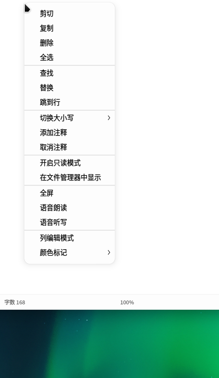

| 菜单项 | 说明 |
| ------------ | ------------ |
| 剪切 | 剪切选中的文本 |
| 复制 | 复制选中的文本 |
| 删除 | 删除选中的文本 |
| 全选 | 选中当前文档的全部内容 |
| 查找 | 打开查找窗口 |
| 替换 | 打开替换窗口 |
| 跳到行 | 跳转到指定行 |
| 切换大小写 | 子菜单，可选择 **大写**/**小写**/**首字母大写** |
| 添加注释/取消注释 | 为代码添加或取消注释 |
| 开启只读模式/关闭只读模式 | 切换只读模式 |
| 在文件管理器中显示 | 在文件管理器中定位当前文件 |
| 全屏 | 切换全屏显示 |
| 语音朗读/语音听写 | 语音相关功能，需系统支持语音服务 |
| 列编辑模式 | 进入或退出列编辑模式 |
| 颜色标记 | 子菜单，可为文本添加或清除颜色标记 |

> 说明：未选中文本时，右键菜单中不显示 **剪切**、**复制**、**删除** 项。

## 主菜单

在主菜单中，您可以新建窗口、新建标签页、[查找文本](#查找文本)、[替换文本](#替换文本)、保存文件、切换窗口主题、查看帮助手册，了解文本编辑器的更多信息。

### 设置

您可以对基础信息、快捷键和高级信息进行设置。

#### 基础设置

1. 单击 > **设置**。
2. 在基础设置选项，您可以选择：
 - 设置字体样式和字号大小。
 - 勾选 **自动换行**，在编辑区自动换行。
 - 勾选 **显示代码折叠标志**，在左侧栏显示按钮或者 ，右键单击按钮选择折叠/展开当前层次或所有层次。
 - 勾选 **显示行号**，在左侧栏显示行号。
 - 勾选 **当前行高亮**，光标所在的行高亮显示。
 - 勾选 **显示书签图标**，在左侧栏显示书签图标。
 - 勾选 **显示空白字符/制表符**，显示文本中的空白字符和制表符，您也可以手动输入或删除空白字符和制表符。
   
   > 窍门：您还可以使用 **Ctrl + “+”/ “-”** 来调节文本编辑器的默认字号。使用 **Ctrl + 0** 恢复默认字号。

#### 快捷键设置

1. 单击  > **设置**，在 **快捷键** 选项查看当前快捷键。
2. 选择一种快捷键映射。
3. 您可以单击并重新输入快捷键，自定义快捷键。

   > 说明: 快捷键映射允许您选择某一种键盘快捷键。您可以使用标准快捷键，Emacs快捷键，或自定义快捷键，以符合您的使用习惯。

#### 高级设置

1. 单击  > **设置**。
2. 在 **高级设置** 选项，您可以设置：
   - **启动**：勾选 **保留关闭前的页签**，重新启动文本编辑器时自动恢复上次关闭时打开的标签页。
   - **窗口**：窗口状态，可选择正常窗口、最大化或全屏。
   - **编辑**：Tab字符宽度，即 Tab 缩进所占用的空间大小；勾选 **允许鼠标中键粘贴**，可使用鼠标中键粘贴剪贴板内容。
   - **打开/保存设置**：
      + **切到最后打开的工程路径**：打开或保存文件时定位到上次使用的工程路径。
      + **与当前文件保持一致**：打开或保存文件时定位到当前文件所在路径。
      + **自定义操作路径**：自行指定打开或保存文件的默认路径。
3. 单击 **恢复默认值**，可将上述设置恢复为默认状态。

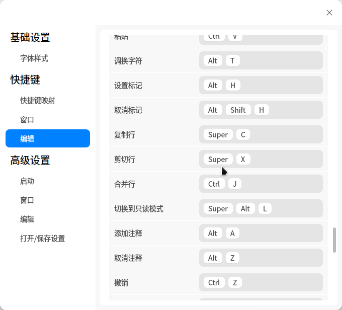

### 主题

窗口主题包含浅色主题、深色主题和跟随系统。

1. 在文本编辑器界面，单击 。
2. 选择 **主题**，选择一个主题颜色。

### 帮助

查看帮助手册，进一步了解和使用文本编辑器。

1. 在文本编辑器界面，单击 。
2. 选择 **帮助**。
3. 查看文本编辑器的帮助手册。

### 关于

1. 在文本编辑器界面，单击 。
2. 选择 **关于**。
3. 查看文本编辑器的版本和介绍。

### 退出

1. 在文本编辑器界面，单击 。
2. 选择 **退出**。
