# 文字編輯器|deepin-editor|

## 概述

文字編輯器是一個簡單的文字編輯工具。您可以用它書寫簡單的文字文件，也可以使用它的進階特性，讓它成為一個程式碼編輯工具，支援程式碼語法突顯。

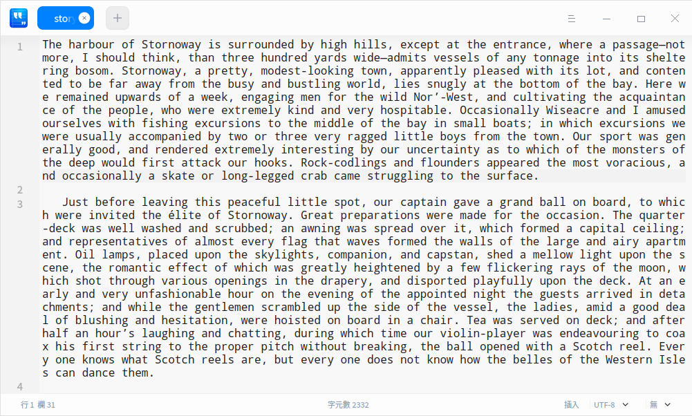

## 使用入門

### 執行文字編輯器

1. 單擊工具列上的啟動器圖示 ，進入啟動器介面。
2. 上下滾動滑鼠滾輪瀏覽或透過搜尋，找到文字編輯器圖示 ，單擊執行。
3. 右鍵單擊，您可以：

 - 單擊 **發送到桌面**，在桌面建立捷徑。
 - 單擊 **發送到工具列**，將應用程式固定到工具列。
 - 單擊 **開機自動啟動**，將應用程式添加到開機啟動項，在電腦開機時自動執行該應用。

### 退出文字編輯器

- 在文字編輯器介面，單擊 ，退出文字編輯器。
- 在文字編輯器介面，單擊主選單  > **退出** ，退出文字編輯器。
- 在工具列右鍵單擊 ，選擇 **關閉所有** ，退出文字編輯器。

### 查看快捷鍵

在文字編輯器介面，使用快捷鍵 **Ctrl + Shift + ?** 打開快捷鍵預覽介面，您也可以在設定介面查看快捷鍵。熟練地使用快捷鍵，將大大提升您的操作效率。

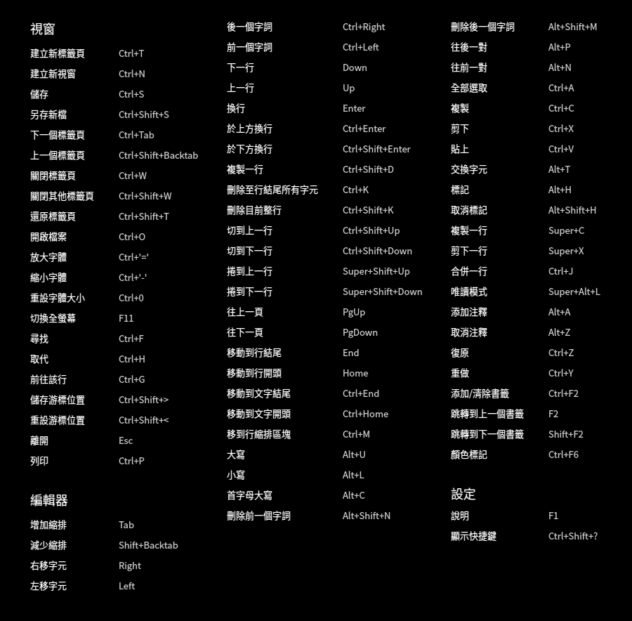

## 基本操作

### 管理分頁

- 建立分頁/視窗

  - 單擊分頁上的按鈕  或  > **新分頁** 或使用快捷鍵 **Ctrl + T** 建立一個新的分頁。
  - 單擊 > **新視窗** 或使用快捷鍵 **Ctrl + N** 建立一個新的視窗。

- 調整分頁/視窗

  - 拖曳同一視窗內的分頁重新排序。
  - 滾動滑鼠切換同一視窗內的分頁。
  - 移出分頁建立一個新的視窗，或者從一個視窗移到另外一個視窗中。

- 關閉分頁/視窗

  當視窗中僅有一個分頁時，關閉分頁的同時也會關閉視窗。

  - 使用快捷鍵 **Ctrl + W** 關閉目前分頁。
  - 單擊分頁上的按鈕  或者單擊滑鼠中鍵，關閉目前分頁。
  - 右鍵單擊分頁，選擇 **關閉分頁** 、**關閉其他分頁** 或 **更多關閉方式** 來關閉分頁。

  > 說明：如果您的文件發生了變化而沒有儲存，文字編輯器會在關閉前提示您儲存更改。

### 打開文件

您可以採用以下方式打開一個或同時打開多個文字文件，選中的文件將會在新分頁打開：

- 直接拖動文件到文字編輯器介面或其圖示上。
- 右鍵單擊文件，選擇 **打開方式** > **文字編輯器**。選擇文字編輯器為預設打開程式後，可直接雙擊打開。
- 在文字編輯器介面，單擊  > **打開文件** 或使用快捷鍵 **Ctrl + O**，在彈出的視窗中選擇文件打開。

### 儲存文件

- 單擊  > **儲存** 或使用快捷鍵 **Ctrl + S**，儲存目前文件。
- 單擊  > **另存為** 或使用快捷鍵 **Ctrl + Shift + S**，另存目前文件。

### 列印文件

在文字編輯器中使用列印，需要提前連接並配置好印表機。

1. 單擊  > **列印** 或使用快捷鍵 **Ctrl + P** 打開列印預覽。
2. 在列印預覽介面，您可以預覽文件，選擇印表機並設定列印頁面。
3. 在列印預覽介面，單擊 **進階設定**，可配置紙張大小、列印方式等相關參數。
4. 單擊 **列印** 即可將文件發送到印表機列印。

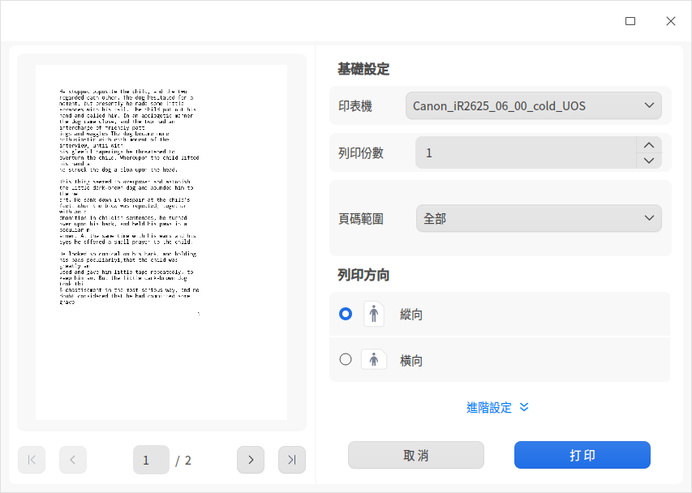

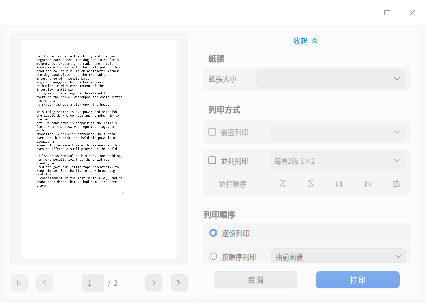

## 編輯文字

### 移動游標

除了使用方向鍵和滑鼠點擊移動游標，您還可以使用以下快捷鍵迅速移動游標：

| 功能                                     | 快捷鍵           |
| ---------------------------------------- | ---------------- |
| 儲存游標位置                             | Ctrl + Shift + > |
| 重設游標位置（跳轉到上次游標儲存的位置） | Ctrl + Shift + < |
| 右移一個詞 （游標向右跳過一個詞）        | Ctrl + 右方向鍵  |
| 左移一個詞 （游標向左跳過一個詞）        | Ctrl + 左方向鍵  |
| 移動到行尾                               | End              |
| 移動到行頭                               | Home             |
| 移動到文字結尾                           | Ctrl + End       |
| 移動到文字開頭                           | Ctrl + Home      |
| 移動到行縮排                             | Ctrl + M         |
| 向右匹配 （游標移動到右括號的後面）      | Alt + P          |
| 向左匹配（游標移動到左括號的前面）       | Alt + N          |

### 切換大小寫

切換大小寫功能可以將選中的文字全部改為大寫字母、小寫字母或者讓首字母大寫。

1. 選中待更改的文字內容。
2. 單擊右鍵，選擇 **切換大小寫**。
3. 選擇 **大寫**/**小寫**/**首字母大寫** 選項，更改會立即生效。

您也可以使用快捷鍵 **Alt + U/ L/ C** 迅速切換大小寫。

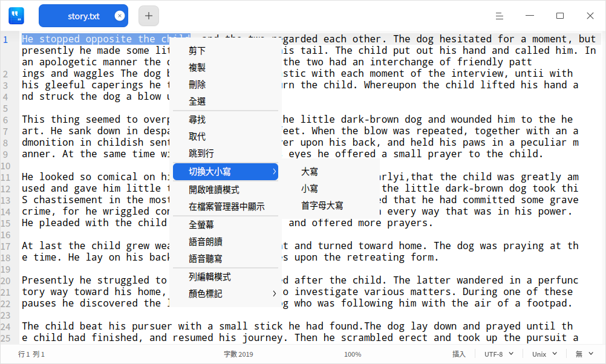

### 突顯文字

文字編輯器支援突顯不同類型的文字。
單擊底部狀態欄最右側的三角符號， 選擇某種文字類型。若文字中有相應內容則會自動突顯。

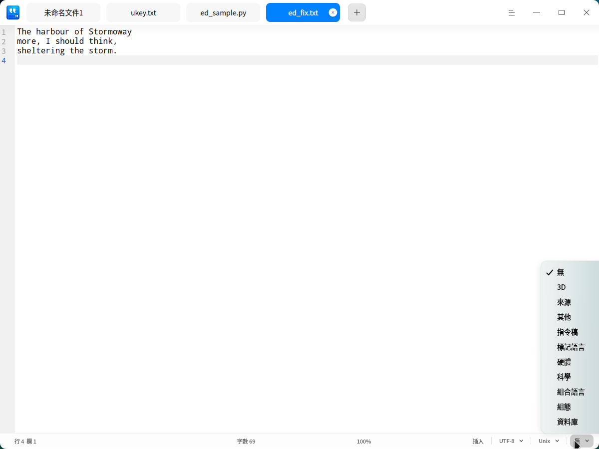

### 刪除文字

除了向左或向右逐個刪除字元外，您還可以使用以下快捷鍵迅速刪除字元：

| 功能           | 快捷鍵           |
| -------------- | ---------------- |
| 刪除到行尾     | Ctrl + K         |
| 刪除目前行     | Ctrl + Shift + K |
| 向左刪除一個詞 | Alt + Shift + N  |
| 向右刪除一個詞 | Alt + Shift + M  |

### 復原操作

如果在編輯文字時發生誤操作，可以使用快捷鍵 **Ctrl + Z** 復原操作，或者在右鍵選單中選擇 **復原**。

### 尋找文字

1. 單擊  > **尋找** 或使用快捷鍵 **Ctrl + F**，打開尋找視窗。
2. 在尋找視窗中，輸入要搜尋的文字。
3. 單擊 **下一個**、**上一個** 逐個尋找，或使用 **Enter** 鍵尋找下一個匹配項。
4. 按下 **Esc** 鍵或單擊關閉按鈕，關閉尋找視窗。

> 竅門：選中一段文字後再進行尋找，則這段文字會自動出現在尋找視窗中。

### 取代文字

1. 單擊  > **取代** 或使用快捷鍵 **Ctrl + H** 或在尋找視窗中單擊 **取代** ，打開取代視窗。
2. 在取代視窗中，輸入要取代的文字以及新文字。
3. 單擊 **取代** 逐個取代；單擊 **剩餘取代**、**全部取代** 一次性取代剩餘的或所有的匹配文字；單擊 **跳過** 不取代目前匹配的文字。
4. 按下 **Esc** 鍵或單擊關閉按鈕，關閉搜尋視窗。

### 跳到行

使用該功能可以迅速跳轉到任一行。
在右鍵選單中選擇 **跳到行** 或者使用快捷鍵 **Ctrl + G** ，輸入行號即可跳轉到相應行。

### 編輯行

您可以使用以下快捷鍵迅速編輯行：

| 功能                           | 快捷鍵               |
| ------------------------------ | -------------------- |
| 向上插入一行（在上方插入一行） | Ctrl + Enter         |
| 向下插入一行（在下方插入一行） | Ctrl + Shift + Enter |
| 複製並貼上目前行               | Ctrl + Shift + D     |
| 上移一行（與上一行交換位置）   | Ctrl + Shift + Up    |
| 下移一行（與下一行交換位置）   | Ctrl + Shift + Down  |
| 向上滾動一行                   | Super + Shift + Up   |
| 向下滾動一行                   | Super + Shift + Down |
| 設定標記                       | Alt + H              |
| 取消標記                       | Alt + Shift + H      |
| 複製行                         | Super + C            |
| 剪下行                         | Super + X            |
| 合併行                         | Ctrl + J             |

### 修改檢視模式

在文字編輯器中打開文件後，右鍵單擊，選擇 **視圖模式** ，在展開的二級選單中選擇所需檢視模式。

各模式說明如下：

1. **編輯視圖**：可自由編輯文字。
2. **查看視圖**：僅可查看文字，不可編輯。
3. **即時閱覽**：僅適用於 Markdown 格式文件。開啟後，可在左側編輯，右側即時展示預覽效果。

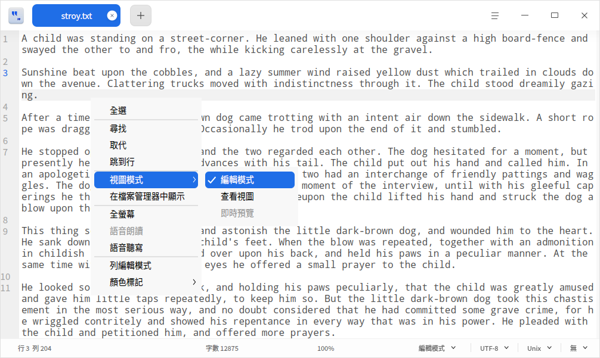

### 語音朗讀

1. 選擇一段文字後，單擊右鍵選擇 **語音朗讀**，將會語音播報選中的文字。

2. 在朗讀過程中，透過單擊朗讀控制項的關閉按鈕可結束語音朗讀。

   > 說明：當未選擇文字時，右鍵選單中 **語音朗讀** 不可啟用，處於置灰狀態。

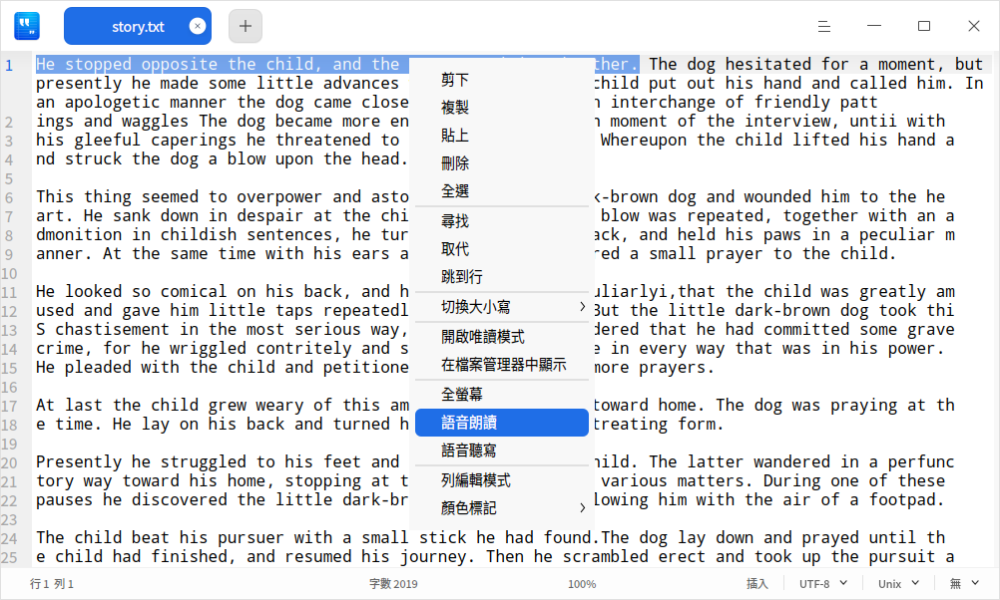

### 語音聽寫

1. 在文字編輯區域內，單擊滑鼠右鍵選擇 **語音聽寫**，透過麥克風輸入語音，轉譯文字將被插入到游標所在位置。

2. 在聽寫模式下，透過單擊聽寫控制項的關閉按鈕可停止語音聽寫。

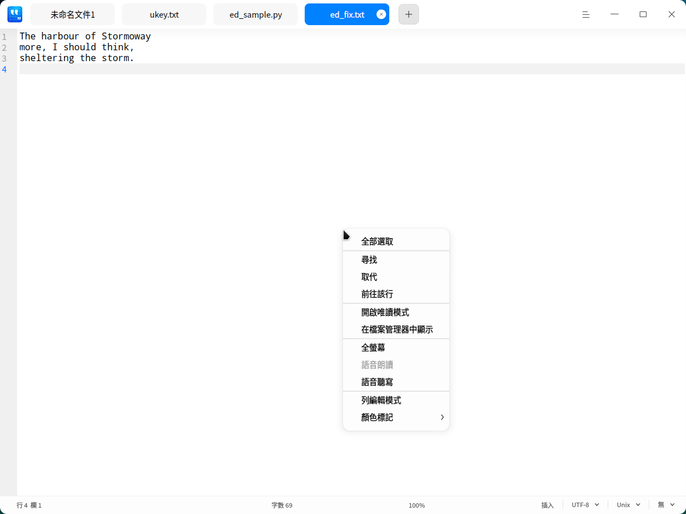

### 列編輯

在文字編輯器介面，按住 **Alt** 鍵不放，滑鼠左鍵單擊多列啟動列編輯模式，為多行程式碼同時編輯相同的內容，提高工作效率。

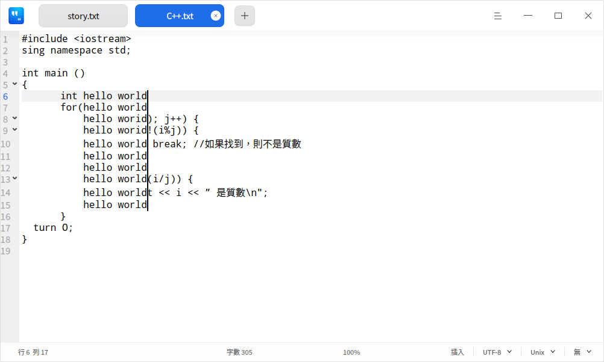

### 顏色標記

在文字編輯器介面，單擊滑鼠右鍵選擇 **顏色標記**，在其下拉選單中進行選擇。

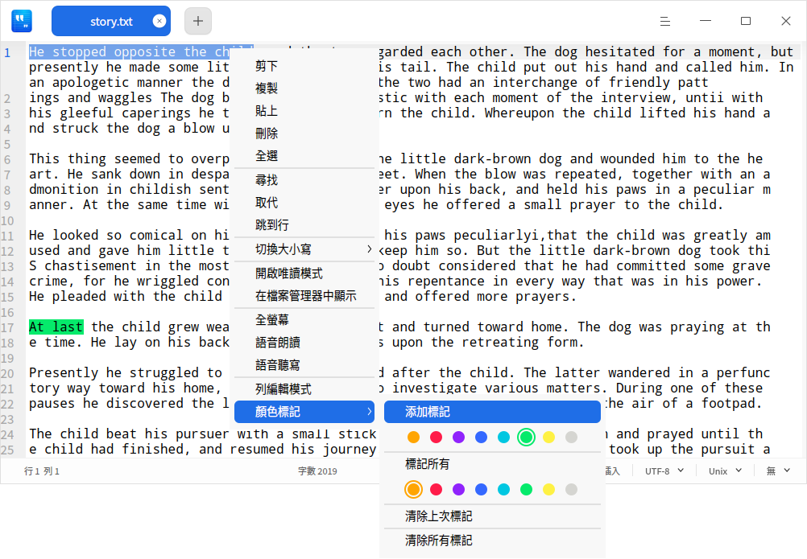

   - **添加標記**：對某一行或某一段文字內容添加顏色標記；有8種顏色按鈕可供選擇。
     + 將游標定在某一行，標記目前所在的行。
     + 選中一段文字內容後，標記選中的文字內容。
   - **標記所有**：將文字內容全部標記或對已選中的文字內容，在全文中標記匹配項；有8種顏色按鈕可供選擇。
     + 將游標定在任意一行，將文字內容全部標記。
     + 選中一段文字內容，在全文中標記匹配項。

   - **清除上次標記**：清除上次標記操作。
   - **清除所有標記**：清除目前所有標記。

### 書籤管理

在文字編輯器設定介面，勾選 **顯示書籤圖示** 後，您可以為任意一行的文字內容添加書籤。將滑鼠指標移至左側欄任意行號前面會顯示圖示 ，添加成功後該行的書籤圖示會變為藍色填充的圖示 。

- 添加書籤

  + 滑鼠左鍵單擊 ，為該行添加書籤。
  + 滑鼠右鍵單擊 ，選擇 **添加書籤**，為該行添加一個書籤。
  + 將游標定在文字中任意一行，使用快捷鍵 **Ctrl + F2** 為該行添加一個書籤。

- 刪除書籤

  + 滑鼠左鍵單擊已填充顏色的書籤圖示，直接刪除該行書籤。
  + 滑鼠右鍵單擊已填充顏色的書籤圖示，選擇 **清除書籤**，刪除該行書籤。
  + 滑鼠右鍵單擊書籤圖示，選擇 **清除所有書籤**，刪除該文字的全部書籤。

   >說明：滑鼠移到左側行號前面才會顯示書籤圖示，移出書籤區域，書籤圖示消失。添加書籤後，該圖示一直顯示。 

### 注釋管理

在文字編輯器介面，您可以對副檔名為.cpp 、.java 、.py等程式碼類型的文件進行添加注釋的操作。

- 添加注釋

  + 選中一段文字內容，單擊右鍵並選擇 **添加注釋**。
  + 選中一段文字內容，使用快捷鍵 **Alt + A** 添加注釋。

- 取消注釋

  + 選中一段已添加注釋的文字內容，單擊右鍵並選擇 **取消注釋**。
  + 選中一段已添加注釋的文字內容，使用快捷鍵 **Alt + Z** 取消注釋。

  >說明：支援不同程式碼語言的注釋，具體以實際為主。例如C，C#，Java注釋符號為 //，Python 注釋符號為 #。

## 主選單

在主選單中，您可以建立視窗、建立分頁、[尋找文字](#尋找文字)、[取代文字](#取代文字)、儲存文件、切換視窗主題、查看說明手冊，了解文字編輯器的更多資訊。

### 設定

您可以對基礎資訊、快捷鍵和進階資訊進行設定。

#### 基礎設定

1. 單擊> **設定**。
2. 在基礎設定選項，您可以選擇：

 - 設定字體樣式和字號大小。

 - 勾選 **自動換行**，在編輯區自動換行。

 - 勾選 **程式碼摺疊標誌**，在左側欄顯示按鈕或者，右鍵單擊按鈕選擇摺疊/展開目前層次或所有層次。

 - 勾選 **顯示行號**，在左側欄顯示行號。

 - 勾選 **目前行突顯**，游標所在的行突顯顯示。

 - 勾選 **顯示書籤圖示**，在左側欄顯示書籤圖示。

 - 勾選 **顯示空白制符/定位符號**，顯示文字中的空白字元和定位符號，您也可以手動輸入或刪除空白字元和定位符號。

   > 竅門：在文字編輯器中，使用 **Ctrl + “+”/ “-”** 調節字號，使用 **Ctrl + 0** 復原預設字號。

#### 快捷鍵設定

1. 單擊  > **設定**，在 **快捷鍵** 選項查看目前快捷鍵。

2. 選擇一種快捷鍵映射。

3. 您可以單擊快捷鍵編輯區域，自訂快捷鍵。

   > 說明: 快捷鍵映射允許您選擇某一種鍵盤快捷鍵。您可以使用標準快捷鍵，Emacs快捷鍵，或自訂快捷鍵，以符合您的使用習慣。

#### 進階設定

1. 單擊  >**設定**。
2. 在 **進階設定** 選項，您可以設定：
   - 視窗狀態：正常視窗，最大化或全螢幕。
   - Tab字元寬度：Tab縮排所占用的空間大小。

### 主題

視窗主題包含淺色主題、深色主題和系統主題。

1. 在文字編輯器介面，單擊 。
2. 選擇 **主題**，選擇一個主題顏色。

### 幫助

查看說明手冊，進一步了解和使用文字編輯器。

1. 在文字編輯器介面，單擊 。
2. 選擇 **幫助**。
3. 查看文字編輯器的幫助手冊。

### 關於

1. 在文字編輯器介面，單擊 。
2. 選擇 **關於**。
3. 查看文字編輯器的版本和介紹。

### 退出

1. 在文字編輯器介面，單擊 。
2. 選擇 **退出**。